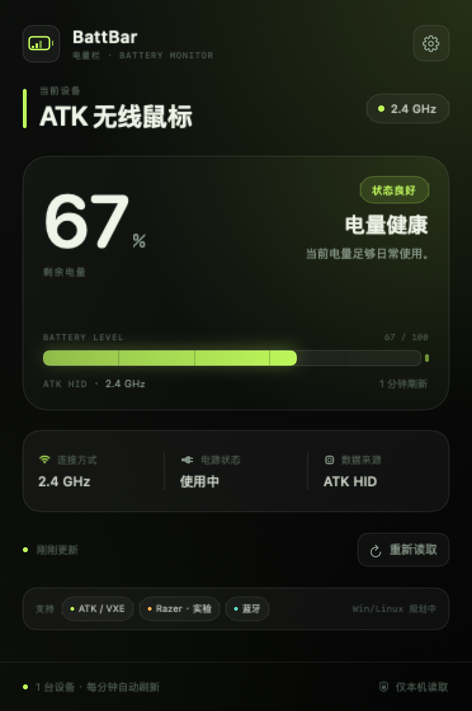

# BattBar

**Wireless mouse battery, at a glance.**
中文: [README.md](README.md) · TODO & hardware checklist: [TODO.md](TODO.md)

BattBar is a tiny menu bar / system tray utility for wireless peripheral battery levels, starting with mice. The macOS app is now a native Swift/AppKit application — no Electron, no GPU process, no background network service. Idle memory footprint is about **14 MB**.

**The name**: Batt (battery) + Bar (menu bar / taskbar). The Chinese name is **电量栏**. It is device-agnostic, so keyboards, headsets, and controllers can join later without a rename.

> The macOS bundle, bundle ID, DMG / ZIP / EXE, and repository all use **BattBar**; the UI and Chinese copy use **电量栏**. A native Windows build is in progress.




## Features

- **Device name + battery in the menu bar** — e.g. `ATK 无线鼠标 ● 67%`, with a color that reflects the level.
- **Horizontal marquee for long names** — names wider than the available menu bar space scroll at 24 pt/s; short names stay still.
- **Vertical rotation for multiple devices** — switches devices every 5.5 seconds; you can also select one in the panel.
- **Hide while another app is fullscreen** — hides the status item and pauses polling; restores automatically when fullscreen ends.
- **ATK / VXE / MAD 2.4G direct read** — uses the Compx HID protocol, no ATK HUB required.
- **Razer Viper V3 Pro 2.4G** — implemented from the OpenRazer 90-byte feature-report protocol. **Experimental; hardware validation is pending.**
- **System Bluetooth mice** — reads battery data macOS already maintains; no Bluetooth scan is started.
- **Low battery alerts** — one notification at 20% and one at 10%; resets after charging or returning above 25%.
- **Last-known reading** — if the receiver does not answer, the previous value stays visible as `~67%` until the mouse wakes.
- **Local first** — no network requests; battery data never leaves the machine.

## Verification status

| Area | Status | Notes |
| --- | --- | --- |
| ATK 2.4G | ✅ Hardware-verified | ATK 1K receiver read 100% (charging) |
| Razer Viper V3 Pro 2.4G | ⚠️ Code complete, hardware pending | See [TODO](TODO.md#p0-razer-viper-v3-pro-24g-hardware-validation) |
| System Bluetooth mice | ⚠️ Code complete, hardware pending | Parser has sample tests; no Bluetooth mouse regression yet |
| Menu bar name + battery | ✅ Implemented and running | Self-test read 100% |
| Long-name marquee | ✅ Implemented + simulated | Overflow and scroll offset verified |
| Multi-device rotation | ✅ Implemented + component test | Index transition and animation verified; real multi-device test pending |
| Fullscreen hide | ✅ Implemented + simulated | A screen-covering test window triggers hide/restore |
| Low memory / CPU | ✅ Measured | ~14 MB idle; CPU close to zero |
| Packaging / docs | ✅ Done | DMG / ZIP / SHA256 / bilingual docs |

## Performance

Measured on Apple M4, macOS 27.0.1, 5K display:

| State | Memory footprint |
| --- | --- |
| Menu bar only, panel closed | ~13–14 MB |
| Panel open | ~32 MB |
| Panel closed again | ~31 MB |

The old Electron build used about 163 MB across the main, GPU, network, and renderer processes — roughly an 80–90% reduction. SwiftUI/AppKit keeps a small graphics cache after the panel closes, so it does not immediately return to 14 MB; however, CPU is effectively idle and there are no extra processes.

Power-saving choices:

- HID polling follows the configured interval (30 s / 1 min / 2 min / 5 min); one read usually takes tens of milliseconds.
- Bluetooth data is cached for 120 seconds to avoid repeatedly launching `system_profiler`.
- The 30 fps timer only runs while a long name is scrolling or a device transition is animating.
- Polling and animation pause while the panel is open, another app is fullscreen, the screen sleeps, or the screen is locked.

## Install

Artifacts live in `release/`:

- macOS (Universal, Apple Silicon + Intel): `BattBar-2.3.0-mac-universal.dmg`
- macOS ZIP fallback: `BattBar-2.3.0-mac-universal.zip`
- Windows x64 (legacy Electron build): `BattBar-2.3.0-win-x64.exe`
- Checksums: `SHA256SUMS.txt`

The app inside the DMG is `BattBar.app` and appears as **BattBar** in Finder; drag it into Applications.

The macOS build is ad-hoc signed. On first launch, right-click the app in Finder and choose **Open**. If Gatekeeper still blocks it:

```bash
xattr -dr com.apple.quarantine "/Applications/BattBar.app"
```

The Windows installer is unsigned; SmartScreen may show “Unknown publisher”. Choose **More info → Run anyway**.

Verify downloads:

```bash
cd release && shasum -a 256 -c SHA256SUMS.txt
# On Windows PowerShell, compare with Get-FileHash and SHA256SUMS.txt
```

### First connection

1. Plug the receiver into USB and switch the mouse to **2.4G mode**.
2. Move the mouse once to wake it.
3. Open BattBar; the battery appears automatically.
4. If ATK HUB or Razer Synapse is holding the receiver, quit it and click **Refresh**.

For a Bluetooth mouse, pair and connect it in System Settings first; nothing else is required.

## Supported devices

| Device | Connection | Read path | Status |
| --- | --- | --- | --- |
| ATK / VXE / MAD | 2.4G receiver | Compx HID report 8 | Adapted; ATK 1K hardware-verified |
| Razer Viper V3 Pro | 2.4G receiver / HyperPolling dongle | Razer 90-byte feature report | Implemented, experimental, hardware pending |
| Other Bluetooth mice | Bluetooth | macOS `system_profiler` | Implemented; depends on what the system reports |
| Other 2.4G brands | 2.4G receiver | — | Needs a per-brand HID adapter |

Verified hardware:

- `ATK Mouse 1K Dongle`, VID `0x373B` / PID `0x101A`, reading 100% while charging.
- The ATK receiver does not expose the mouse model, so the app shows “ATK 无线鼠标”. A Bluetooth connection shows the system-provided name.

Razer targets:

- Viper V3 Pro wireless PID `0x00C1`; HyperPolling wireless dongle PID `0x00B3` (VID `0x1532` for both).
- Transaction ID, CRC, battery/charging commands, and timing were checked against the OpenRazer sources. No physical device was available, so it remains experimental.
- Plug in the Razer receiver and the panel will try to identify it. A successful read shows “Razer Viper V3 Pro” or “Razer 无线鼠标”.
- For debugging, run `"/Applications/BattBar.app/Contents/MacOS/BattBar" --probe` to see the raw discovery result.

## Adding device support

The code is split by **device provider**; the UI and scheduler do not know about brands:

```text
Sources/Providers/
  Models.swift             Device model, battery text, priority
  ProviderProtocol.swift   DeviceProvider protocol
  HIDSupport.swift         IOHIDManager discovery
  ATKProtocol.swift        ATK packet / checksum / decoding
  ATKProvider.swift        ATK receiver discovery and reads
  RazerProtocol.swift      Razer packet / CRC / decoding
  RazerProvider.swift      Razer battery and charging state
  BluetoothProvider.swift  System Bluetooth mice
```

A new 2.4G brand usually needs only four steps:

1. Find the receiver VID/PID, vendor HID collection, and report descriptor.
2. Implement request packing, checksum, and response decoding in `XxxProtocol.swift` (pure logic, unit-testable).
3. Implement discovery, write, wait, and conversion to `MouseDevice` in `XxxProvider.swift`.
4. Register it in the `Scanner` HID provider list; the panel, menu bar, and notifications are reused automatically.

Protocol notes:

- [ATK / Compx protocol](docs/atk-protocol.md)
- [Razer protocol](docs/razer-protocol.md)

### Hardware probe

A standalone cross-platform HID probe (Windows / macOS / Linux, Node.js 24; CI and the legacy Windows build use 24) is included for hardware validation without rebuilding the app:

```bash
npm install
npm run probe:hid      # enumerate VID/PID/usage/report descriptor
npm run probe:atk      # send ATK report 8 and print the raw reply
npm run probe:razer    # send the Razer 90-byte feature report and print the raw reply
```

Source: [tools/hid-probe.js](tools/hid-probe.js). Full steps and failure triage are in [TODO.md](TODO.md) (currently Chinese).

### Cross-platform plan

Current priority:

1. **Make the native macOS app solid for daily use** (current): low memory, ATK / Razer / Bluetooth, menu bar scrolling and fullscreen hiding, DMG release.
2. **Build the native Windows app**: HIDAPI transport + native tray UI; the Electron build remains a stopgap.

The target is macOS and Windows, with platform-native UI and HID transports to keep memory low (Linux is out of scope):

| Platform | UI | HID transport | Status |
| --- | --- | --- | --- |
| macOS | Swift + AppKit | IOKit `IOHIDDevice` | Current |
| Windows | Native Win32 / .NET tray (TBD) | HIDAPI | Planned; legacy Electron build available |

Packet layouts, checksums, battery scaling, and test vectors stay platform-independent. The Electron code remains as the Windows stopgap and as a reference implementation; it is no longer the macOS release.

## macOS development

Requirements: macOS 13+, Xcode Command Line Tools (full Xcode is not required).

```bash
cd macos

./scripts/build-native.sh     # build the Universal .app
./scripts/test-native.sh      # protocol / Bluetooth parser / settings tests
open build/BattBar.app

./scripts/package-native.sh   # build DMG / ZIP and refresh release/SHA256SUMS.txt
```

Output:

```text
macos/build/BattBar.app
```

The script picks a compatible Command Line Tools SDK automatically. If the installed SDK does not match the compiler, set it explicitly:

```bash
BATTBAR_SDK=/Library/Developer/CommandLineTools/SDKs/MacOSX26.5.sdk \
  ./scripts/build-native.sh
```

Apple Silicon only:

```bash
ARCHS=arm64 ./scripts/build-native.sh
```

### CI / release

- `.github/workflows/ci.yml`: no longer runs on push; trigger it manually from the Actions tab when needed. It runs native macOS tests / Universal build / DMG / ZIP and the legacy Windows Electron tests and installer build.
- `.github/workflows/release.yml`: the only automatic build path. On a `v*` tag it builds macOS DMG / ZIP and the Windows EXE, generates `SHA256SUMS.txt`, and creates a GitHub Release.
- `release/` is ignored by Git; artifacts are distributed through GitHub Releases instead of being committed.

### Native source layout

```text
macos/
  BattBar/Sources/
    App/            Entry point, settings, scheduler, self-test, preview renderer
    MenuBar/        Status item view, marquee, rotation, fullscreen monitor
    Panel/          SwiftUI panel, NSPopover controller
    Providers/      ATK / Razer / Bluetooth adapters
    Services/       Notifications, launch at login
  BattBar/Tests/
  scripts/
    build-native.sh
    test-native.sh
    package-native.sh
  build/            Local build output

tools/
  hid-probe.js      Cross-platform HID hardware probe
```

## Windows (legacy Electron build)

Requires Node.js 24 (the same version used by GitHub Actions). The Windows build still uses the original Electron implementation. The ATK protocol matches macOS. Generic Bluetooth battery support depends on Windows PnP battery properties and may not work on every mouse.

```bash
npm install
npm start          # development
npm test           # legacy Node tests
npm run pack:win   # Windows x64 NSIS installer
```

See [TODO.md](TODO.md#p0-native-windows-app) for the native Windows design, limitations, and hardware checklist. In particular, the Windows notification area supports icons, not macOS-style text; the Windows app will use a combination of a battery icon, digits, and tooltips. The exact design is still open.

## Troubleshooting

**ATK / Razer receiver does not respond**

- A sleeping mouse may prevent the receiver from answering. Move the mouse and retry.
- Quit ATK HUB, Razer Synapse, or any other app holding the HID interface.
- Replug the receiver and confirm it appears in System Information → USB.
- Open Settings → **Copy diagnostics**; recent scan results and error codes are included.
- For a deeper look:

```bash
"/Applications/BattBar.app/Contents/MacOS/BattBar" --probe
```

**Bluetooth mouse does not appear**

- Make sure it is **connected**, not merely paired, in System Settings.
- macOS filters for mouse / pointing devices; headphones and other devices are ignored.
- On Windows, a device that does not expose PnP battery properties will not show a level.

**The menu bar shows `~25%`**

That is the last successful reading. The `~` means it is not fresh; it updates automatically when the mouse wakes.

**The menu bar item disappeared**

With **Hide while another app is fullscreen** enabled, the status item hides during fullscreen apps and returns when you leave fullscreen or switch to the desktop.

**No low battery notifications**

- macOS: System Settings → Notifications → “BattBar” and allow notifications.
- Permission is requested when alerts are first enabled. You can also use **Send test notification**.

## Privacy

- No network requests.
- No Bluetooth scanning permission; macOS data is read from what the system already maintains.
- HID traffic consists only of read-only battery queries; no device configuration is written.
- Settings and diagnostics stay on the local machine.

## License

[MIT](LICENSE)
